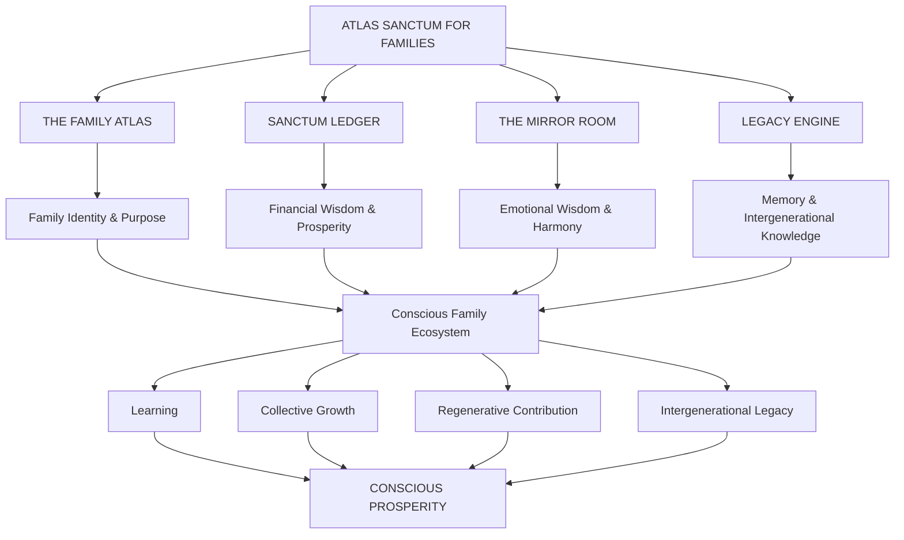
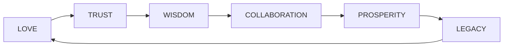
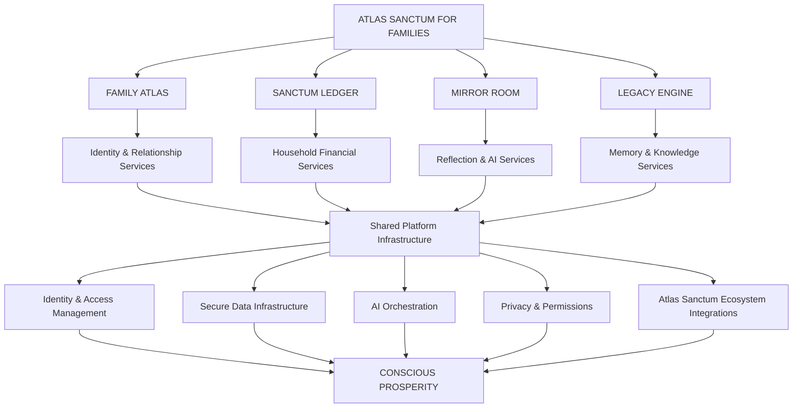

# ❤️ ATLAS SANCTUM FOR FAMILIES
## Where Love Meets Legacy

### A Family's Map to Conscious Prosperity

  <strong>THE FAMILY OPERATING SYSTEM FOR CONSCIOUS PROSPERITY</strong>
   
  <em>Transform your home into a living sanctum where purpose, financial wisdom, and collective intelligence thrive together.</em>

  <a href="#-vision">Vision</a> •
  <a href="#-core-modules">Core Modules</a> •
  <a href="#-philosophy">Philosophy</a> •
  <a href="#-architecture">Architecture</a> •
  <a href="#-impact-vision">Impact</a> •
  <a href="#-roadmap">Roadmap</a>

---

> "The family is not just a unit of society — it is a living sanctum, a sovereign ecosystem where purpose and prosperity are consciously cultivated."

---

# 🌱 01. Our Vision

What if a family could become more than a household?

What if it could become a living ecosystem of wisdom, emotional intelligence, financial resilience, creativity, and intergenerational prosperity?

Modern families navigate increasingly complex realities:

- Fragmented financial decision-making.
- Limited intergenerational knowledge transfer.
- Emotional disconnection.
- Competing individual priorities.
- Loss of cultural and ancestral knowledge.
- Increasingly complex digital environments.
- Difficulty aligning individual dreams with collective purpose.

Yet families remain among humanity's most important institutions.

**Atlas Sanctum for Families** is envisioned as an intelligent digital environment that helps families organize their shared lives around purpose, responsibility, wisdom, and love.

It brings together family identity, financial intelligence, guided reflection, and legacy preservation into one interconnected ecosystem.

Our vision is to help families:

- Understand their shared values and aspirations.
- Build healthy financial habits.
- Strengthen emotional communication.
- Preserve family history and cultural knowledge.
- Encourage lifelong learning.
- Develop intergenerational mentorship.
- Coordinate meaningful family goals.
- Create a legacy that extends beyond individual lifetimes.

**We believe prosperity is not simply what a family accumulates. It is what a family cultivates, shares, preserves, and passes forward.**

---

# 🏛️ 02. The Mission

Our mission is to build a Family Operating System that connects the emotional, intellectual, cultural, and economic dimensions of family life.

Atlas Sanctum transforms the household into a conscious ecosystem through four interconnected pillars:

| Pillar | Purpose |
|---|---|
| The Family Atlas | Discover identity, values, relationships, and aspirations |
| Sanctum Ledger | Develop financial wisdom and regenerative household economics |
| The Mirror Room | Strengthen reflection, emotional understanding, and communication |
| Legacy Engine | Preserve family wisdom and connect generations |

Together, these systems create a digital environment where families can grow intentionally while maintaining their individual identities and autonomy.

---

# 🧬 03. Core Modules

## I. The Family Atlas
### Mapping the Architecture of Family Life

The Family Atlas is the central identity and relationship environment of the platform.

It creates a living map of a family's values, dreams, milestones, relationships, and shared aspirations.

Rather than treating family information as disconnected records, the Family Atlas organizes it into a meaningful picture of the family's collective journey.

### Core Capabilities

**Family Identity Mapping**
- Family values and principles.
- Shared mission and vision.
- Family traditions.
- Cultural and ancestral connections.
- Household identity.

**Personal Journey Nodes**
- Individual goals.
- Personal milestones.
- Education and development.
- Skills and interests.
- Life experiences.
- Individual aspirations.

**Collective Journey Mapping**
- Shared family milestones.
- Family projects.
- Collective achievements.
- Important dates and events.
- Intergenerational relationships.

**AI-Powered Family Intelligence**
- Goal alignment assistance.
- Family activity recommendations.
- Personalized learning suggestions.
- Collaborative planning.
- Optional family reflection summaries.

### Family Harmony Modeling

The Family Atlas explores tools for understanding family dynamics and identifying opportunities for healthier communication.

Potential features include:
- Voluntary wellbeing check-ins.
- Self-reported emotional reflections.
- Communication patterns.
- Shared goal alignment.
- Conflict-prevention resources.

Emotional information must remain private by default. AI should never claim to objectively diagnose a family member's emotional state or infer sensitive feelings without their participation.

**Philosophy:**

Every family has a story. Every individual has a journey. Together, those journeys create a living family legacy.

---

## II. Sanctum Ledger
### A Family Economy Built on Trust and Regenerative Values

Sanctum Ledger introduces a household financial intelligence system designed to encourage transparency, responsible decision-making, and long-term prosperity.

It goes beyond conventional expense tracking by connecting everyday financial decisions with family values and collective aspirations.

### Core Capabilities

**Household Financial Intelligence**
- Income tracking.
- Expense management.
- Budget planning.
- Savings goals.
- Household financial summaries.
- Shared financial planning.

**Family Value Exchange**
- Family contributions.
- Financial commitments.
- Giving and philanthropy.
- Shared project funding.
- Community participation.

**Regenerative Value Exchange (RVE)**

Sanctum Ledger explores an integration with Atlas Sanctum's broader Regenerative Value Exchange vision.

Potential applications include:
- Tracking regenerative contributions.
- Representing eligible impact-related assets.
- Supporting family philanthropy.
- Recording educational and sustainability initiatives.
- Connecting household projects to wider regenerative ecosystems.

**Conscious Prosperity Analytics**

The platform can help families understand:
- Spending patterns.
- Savings progress.
- Educational investments.
- Charitable contributions.
- Sustainability-related expenditure.
- Progress toward collective goals.

### Wisdom-Driven Economics

The central philosophy is to expand the definition of household wealth.

Financial resources matter, but so do education, meaningful relationships, knowledge, health, and the ability to contribute positively to the world.

Any tokenized financial functionality should be implemented with clear legal, security, consumer protection, and asset-accounting safeguards. RVE should not imply guaranteed returns or monetary value.

**Philosophy:**

Money should serve family purpose, not become the family's purpose.

---

## III. The Mirror Room
### A Sanctuary for Reflection, Emotional Wisdom, and Purpose

The Mirror Room is the emotional reflection and personal development environment of Atlas Sanctum.

It creates a private space where family members can reflect on experiences, understand different perspectives, develop emotional awareness, and work toward healthier relationships.

### Core Capabilities

**Conversational AI Reflection**
- Guided self-reflection.
- Emotional journaling.
- Personal growth exercises.
- Perspective-taking activities.
- Purpose discovery.
- Values clarification.

**Wisdom Traditions**

The Mirror Room draws inspiration from diverse philosophical and spiritual traditions, including:

- Stoicism.
- Buddhism.
- Biblical wisdom and discernment.
- African philosophical traditions.
- Contemporary psychology.
- Restorative communication practices.

These traditions provide sources of reflection rather than rigid doctrines.

**Family Harmony Tools**
- Guided conversations.
- Conflict reflection exercises.
- Forgiveness and reconciliation resources.
- Shared values exploration.
- Communication prompts.
- Family appreciation practices.

**Personal Development**
- Daily reflection.
- Gratitude journaling.
- Character development.
- Goal alignment.
- Mindfulness exercises.
- Learning pathways.

### A Safe Reflection Environment

The Mirror Room should prioritize psychological safety and personal autonomy.

Its AI capabilities should:
- Respect individual privacy.
- Avoid diagnosing mental health conditions.
- Avoid manipulating emotional vulnerabilities.
- Never force reconciliation or forgiveness.
- Encourage qualified professional assistance when appropriate.
- Give each family member control over personal reflections.

Parents and guardians should not automatically receive unrestricted access to the private journals of other family members, particularly adolescents.

**Philosophy:**

A harmonious family is not one without disagreement. It is one that learns how to navigate differences with wisdom, dignity, and compassion.

---

## IV. Legacy Engine
### Preserving Wisdom Across Generations

The Legacy Engine is the family memory and intergenerational knowledge preservation environment.

Its purpose is to ensure that family stories, experiences, wisdom, traditions, and meaningful contributions do not disappear with time.

It transforms fragmented memories into a living family archive.

### Core Capabilities

**Family Memory Archive**
- Letters.
- Photographs.
- Audio recordings.
- Video memories.
- Personal reflections.
- Family documents.
- Historical milestones.

**Ancestral Knowledge**
- Family history.
- Ancestry records.
- Oral traditions.
- Cultural practices.
- Historical narratives.
- Family wisdom.

**Family Codex**

The Family Codex is a dynamic collection of the family's values, principles, lessons, traditions, and important experiences.

It may include:
- Foundational family values.
- Stories from previous generations.
- Lessons learned.
- Important family decisions.
- Shared aspirations.
- Personal messages for future generations.

**Intergenerational Connections**
- Family storytelling.
- Mentorship activities.
- Shared learning experiences.
- Knowledge exchange.
- Cross-generational conversations.
- Family history exploration.

**Living Legacy**

The Legacy Engine should evolve alongside the family, allowing each generation to contribute its own chapter to an ongoing family narrative.

### Atlas Sanctum Wisdom Network

The Legacy Engine is designed to connect with the broader Atlas Sanctum knowledge ecosystem.

This creates opportunities for families to exchange educational resources, discover philosophical traditions, and participate in shared learning initiatives.

Family archives remain private by default. Sharing with external networks must require deliberate authorization and appropriate consent from the people represented in those records.

**Philosophy:**

A family legacy is not merely what ancestors leave behind. It is also what future generations are empowered to create.

---

# 🧭 04. The Four Pillars Working Together

The strength of Atlas Sanctum comes from the interaction between its four core modules.

### The Family Growth Cycle

1. **Discover** — Understand the family's identity and shared aspirations.
2. **Organize** — Build healthy economic and household systems.
3. **Reflect** — Develop emotional intelligence and communication.
4. **Preserve** — Document family knowledge and experiences.
5. **Grow** — Turn collective wisdom into meaningful action.
6. **Transmit** — Pass knowledge, values, and opportunities to future generations.

---

# ❤️ 05. Our Philosophy
## The Foundation of Conscious Prosperity

Atlas Sanctum for Families is grounded in three foundational ideas.

### I. Love as Governance

Love is more than an emotion. It can become a guiding principle for how families make decisions, share responsibilities, resolve disagreements, and support one another.

A conscious family ecosystem encourages:

- Empathy.
- Discernment.
- Mutual respect.
- Shared responsibility.
- Compassionate communication.
- Respect for individual autonomy.

The objective is to make care visible in everyday decisions without turning relationships into automated scores or performance evaluations.

### II. Wisdom as Currency

Conventional economic systems frequently measure wealth through financial accumulation.

Atlas Sanctum proposes a broader understanding of prosperity.

Knowledge, learning, experience, mentorship, creativity, and contribution are also forms of family wealth.

A family becomes richer when its members learn, teach, grow, and share.

### III. Legacy as Design

A family's future should not be left entirely to chance.

Families can consciously cultivate:
- Ethical foundations.
- Financial resilience.
- Cultural continuity.
- Educational opportunities.
- Community contribution.
- Intergenerational knowledge.
- Shared long-term aspirations.

Every home can become a small laboratory of innovation, ethics, learning, and cultural preservation.

---

# 🌳 06. The Family as a Regenerative Ecosystem

Atlas Sanctum extends the principles of conscious prosperity into a broader understanding of family life.

The family becomes an interconnected ecosystem with several dimensions.

| Dimension | Regenerative Focus |
|---|---|
| Emotional | Empathy, communication, and wellbeing |
| Financial | Savings, responsible spending, and giving |
| Intellectual | Education, curiosity, and shared learning |
| Cultural | Traditions, ancestry, and identity |
| Social | Relationships and community contribution |
| Environmental | Sustainable household practices |
| Creative | Innovation, imagination, and collaboration |
| Intergenerational | Mentorship and legacy preservation |

### Family Regeneration Loop

A family's strength grows through the continuous exchange of knowledge, care, resources, and meaningful contributions.

---

# 📊 07. Impact Vision
## A Global Wisdom-Driven Family Network

Our long-term ambition is to build a global network of one million families committed to conscious prosperity, collective learning, and intergenerational development.

### The One Million Families Vision

**1M+ Families United**

A long-term participation ambition connecting families across cultures and geographies.

**∞ Generations Connected**

A commitment to preserving wisdom and strengthening intergenerational relationships.

**100% Love-Driven**

A guiding aspiration for a family ecosystem built around care, respect, and shared responsibility.

These are aspirational vision statements, not current user counts or independently measured platform outcomes.

### Impact Measurement Framework

Atlas Sanctum seeks to measure progress across four major dimensions.

#### 1. Household Stress Reduction

Understand whether improved financial organization, communication, and family planning help reduce reported household burdens.

Potential indicators:
- Self-reported financial stress.
- Household budgeting consistency.
- Financial goal completion.
- Family resource planning.

#### 2. Shared Learning Hours

Measure the time families dedicate to collective education and development.

Potential indicators:
- Shared learning sessions.
- Educational activities.
- Reading and research engagement.
- Intergenerational teaching.
- Collaborative projects.

#### 3. Intergenerational Mentorship

Evaluate the growth of knowledge exchange between generations.

Potential indicators:
- Mentorship sessions.
- Oral history contributions.
- Skills transferred.
- Family storytelling activities.
- Knowledge preservation.

#### 4. Family Harmony Index

Explore voluntary, self-reported indicators of family wellbeing and relationship quality.

Potential indicators:
- Communication satisfaction.
- Sense of belonging.
- Perceived mutual support.
- Conflict-resolution confidence.
- Shared purpose alignment.

The Family Harmony Index should never be used to diagnose individuals, rank families publicly, or determine access to services. Measurement should remain voluntary, contextual, privacy-preserving, and scientifically evaluated.

---

# 🌐 08. Positioning & Design Philosophy

Atlas Sanctum for Families combines the elegance of consumer technology with the analytical capabilities of intelligent systems and the emotional depth of human-centered design.

### The Apple of Family OS

Elegant, intelligent, emotion-aware.

A refined user experience that makes complex family organization feel intuitive.

### The Palantir of the Heart

Data for empathy, not exploitation.

Advanced family intelligence focused on understanding relationships, supporting decisions, and protecting personal dignity.

### The Community of the Future

Unity without uniformity.

A shared environment where families can learn from one another while respecting different cultures, values, beliefs, and individual freedoms.

### Visual Identity

The experience should communicate:

- Warmth.
- Trust.
- Serenity.
- Wisdom.
- Timelessness.
- Elegance.
- Belonging.
- Intergenerational continuity.

The interface should feel like a digital home rather than a financial application or productivity dashboard.

---

# 🧠 09. AI & Family Intelligence

Artificial intelligence provides an assistance layer across the four modules.

Rather than replacing family judgment, AI should help families organize information, discover patterns, explore options, and make more informed decisions.

### Potential AI Capabilities

| Module | AI Application |
|---|---|
| Family Atlas | Goal alignment and family planning assistance |
| Sanctum Ledger | Budget summaries and financial organization |
| Mirror Room | Guided reflection and communication prompts |
| Legacy Engine | Story organization and family archive assistance |

### Family Intelligence Principles

- Human-centered recommendations.
- Explainable AI interactions.
- Personalized assistance.
- Privacy-preserving processing.
- Context-aware support.
- Clear boundaries on automated decisions.
- Respect for different beliefs and values.
- Human control over sensitive information.

AI should never become an authority over a family.

It should remain a tool that helps people make wiser choices together.

---

# 🔐 10. Privacy, Security & Family Data Sovereignty

Family information is among the most sensitive information a digital platform can hold.

It may include financial records, personal reflections, family relationships, photographs, ancestry information, and information about children.

Privacy must therefore be foundational rather than optional.

### Core Principles

**Privacy by Design**

Personal information should only be collected when necessary for a clearly defined purpose.

**Family Data Sovereignty**

Families should have meaningful control over their records, sharing permissions, and digital archives.

**Individual Autonomy**

Each participating member should retain appropriate control over their own personal information.

**Consent-Based Sharing**

Family members must have clear permissions for accessing shared and private content.

**Security by Design**

Sensitive financial records, personal reflections, and identity information require strong access controls and encryption.

**Data Minimization**

Avoid collecting sensitive information simply because it may be useful for future AI features.

**Child Protection**

Age-appropriate interfaces, guardian responsibilities, and additional protections for minors must be incorporated into platform design.

### Suggested Privacy Architecture

- Private-by-default family workspaces.
- Role-based and individual access permissions.
- Encrypted storage for sensitive records.
- Explicit sharing controls.
- Data export and deletion capabilities.
- Audit logs for sensitive access.
- Separate private and shared journals.
- Restricted access to children's information.
- Clear retention policies.

---

# 🏗️ 11. Technical Architecture

Atlas Sanctum for Families is designed as a modular Family OS connecting identity, household economics, emotional intelligence, and legacy infrastructure.

### Conceptual Architecture

### Engineering Priorities

- Modular application architecture.
- Secure family identity management.
- Granular access control.
- Privacy-preserving AI integration.
- Secure financial data processing.
- Reliable family archive storage.
- Searchable knowledge repositories.
- Accessible cross-platform interfaces.
- Data export and portability.
- Interoperability with the wider Atlas Sanctum ecosystem.

Specific implementation technologies should be documented according to the actual repository stack.

---

# 🌍 12. Integration with the Atlas Sanctum Ecosystem

Atlas Sanctum for Families is envisioned as a specialized family-focused environment within the wider Atlas Sanctum vision.

It connects the household to a broader world of knowledge, regenerative value creation, sustainability, and collective innovation.

### Potential Ecosystem Connections

| Atlas Sanctum Platform | Family Application |
|---|---|
| Regenerative Value Exchange | Family philanthropy and regenerative contributions |
| Knowledge Hub | Shared learning and research |
| Innovation Labs | Family innovation and creative projects |
| Investment Hub | Financial education and responsible investment discovery |
| Community | Family collaboration and mentorship |
| Governance | Participatory decision-making |
| Impact Intelligence | Household sustainability and community impact |

The family becomes a meaningful unit of participation in a larger regenerative ecosystem without surrendering its independence or privacy.

---

# 🗺️ 13. Development Roadmap

The platform is envisioned to evolve through progressive development stages.

## Phase I — Family Identity Foundation

- [ ] Develop family onboarding.
- [ ] Create family profiles.
- [ ] Build the Family Atlas.
- [ ] Introduce values and aspirations mapping.
- [ ] Implement personal journey nodes.
- [ ] Establish shared family workspaces.

## Phase II — Sanctum Ledger

- [ ] Develop household expense management.
- [ ] Implement family budgeting.
- [ ] Introduce savings goals.
- [ ] Build shared financial planning.
- [ ] Add giving and philanthropy tracking.
- [ ] Explore regenerative value integrations.

## Phase III — The Mirror Room

- [ ] Develop guided reflection.
- [ ] Implement private journaling.
- [ ] Introduce conversational AI.
- [ ] Build family communication exercises.
- [ ] Develop personal purpose discovery.
- [ ] Establish emotional privacy safeguards.

## Phase IV — Legacy Engine

- [ ] Develop family archives.
- [ ] Introduce multimedia memory collections.
- [ ] Build the Family Codex.
- [ ] Introduce family storytelling.
- [ ] Develop ancestry and knowledge connections.
- [ ] Establish intergenerational learning workflows.

## Phase V — Family Intelligence

- [ ] Integrate AI assistance across modules.
- [ ] Introduce family goal coordination.
- [ ] Develop privacy-preserving insights.
- [ ] Introduce shared learning recommendations.
- [ ] Build voluntary impact analytics.
- [ ] Develop family wellbeing indicators.

## Phase VI — Global Family Network

- [ ] Launch the Atlas Sanctum Wisdom Network integration.
- [ ] Expand multilingual support.
- [ ] Introduce family learning communities.
- [ ] Establish intergenerational mentorship initiatives.
- [ ] Support cross-cultural knowledge exchange.
- [ ] Develop partnerships with educational and family organizations.

*Roadmap items represent development ambitions, not confirmed completed functionality.*

---

# 🤝 14. Community & Collaboration

We believe families should not have to navigate every challenge alone.

Atlas Sanctum seeks to build a global community of families, educators, researchers, financial literacy advocates, and innovators.

### Potential Community Participants

- Families across different cultures.
- Educators.
- Family researchers.
- Financial literacy advocates.
- Psychologists and wellbeing professionals.
- Historians and genealogists.
- Community organizations.
- Cultural preservation initiatives.
- Technology developers.
- Intergenerational mentorship networks.

### Collaboration Opportunities

- Family learning initiatives.
- Financial education.
- Cultural preservation.
- Intergenerational mentorship.
- Emotional wellbeing research.
- Regenerative family projects.
- Digital family archives.
- Community development.

---

# 🔬 15. Research & Knowledge Domains

Atlas Sanctum for Families intersects several disciplines.

| Discipline | Research Direction |
|---|---|
| Family Systems Theory | Family relationships and development |
| Behavioral Economics | Household decision-making |
| Psychology | Emotional awareness and wellbeing |
| Financial Literacy | Family financial resilience |
| Education | Lifelong and intergenerational learning |
| Philosophy | Wisdom, ethics, and purpose |
| Anthropology | Culture and family traditions |
| Digital Humanities | Historical and cultural preservation |
| Artificial Intelligence | Human-centered family assistance |
| Information Security | Family privacy and data protection |

---

# 📈 16. Long-Term Impact

The ultimate ambition is to cultivate a global ecosystem of one million families building conscious prosperity together.

We envision families that:

- Communicate with greater understanding.
- Make informed financial decisions.
- Preserve their cultural heritage.
- Invest in education.
- Support one another across generations.
- Develop meaningful shared projects.
- Contribute to their communities.
- Create enduring legacies.

The true measure of success will not simply be the number of households using the application.

It will be whether families become better equipped to care for one another, make informed decisions, preserve wisdom, and create meaningful futures.

---

# 🤝 17. Contributing

We welcome developers, designers, researchers, educators, and innovators interested in building a new generation of family-centered digital infrastructure.

### Contribution Areas

- Frontend and backend engineering.
- AI and machine learning.
- Privacy engineering.
- Cybersecurity.
- Financial technology.
- Family systems research.
- User experience and design.
- Digital archives.
- Knowledge management.
- Educational technology.
- Cultural preservation.

### Contribution Process

1. Explore the repository.
2. Review available documentation.
3. Identify an issue or improvement.
4. Discuss significant design or architecture decisions.
5. Submit contributions with appropriate tests and documentation.

Detailed contribution guidelines will be maintained as the development community expands.

---

# 📜 18. License

The project license has not yet been specified.

An appropriate license should be selected before establishing public redistribution and contribution terms.

---

# 🌸 19. Our Declaration

We believe love should guide how families make decisions.

We believe wisdom should be passed from one generation to another.

We believe financial prosperity should serve meaningful human purposes.

We believe every individual deserves dignity, privacy, and autonomy within the family.

We believe family history is a treasure worth preserving.

We believe children deserve a future shaped by knowledge, compassion, and opportunity.

We believe the strongest legacies are built through everyday acts of care, responsibility, and shared growth.

**A family is not simply a collection of people sharing a home. It is a living network of relationships, memories, values, and possibilities.**

Atlas Sanctum exists to help families cultivate that potential.

---

# ❤️ ATLAS SANCTUM FOR FAMILIES

## Where Love Meets Legacy.

### A Family's Map to Conscious Prosperity.

**One Family. Many Journeys. Generations of Wisdom.**

  <strong>ATLAS SANCTUM</strong>
   
  <em>LOVE AS FOUNDATION. WISDOM AS WEALTH. LEGACY AS DESTINY.</em>
    
  🌍 Built with love for families worldwide.
    
  © 2026 Atlas Sanctum.

